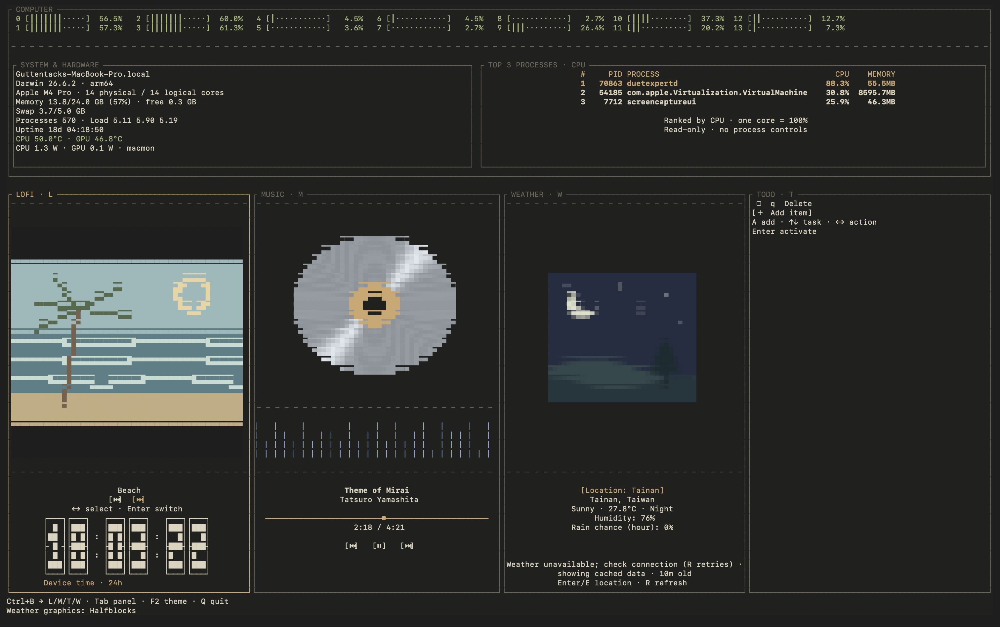
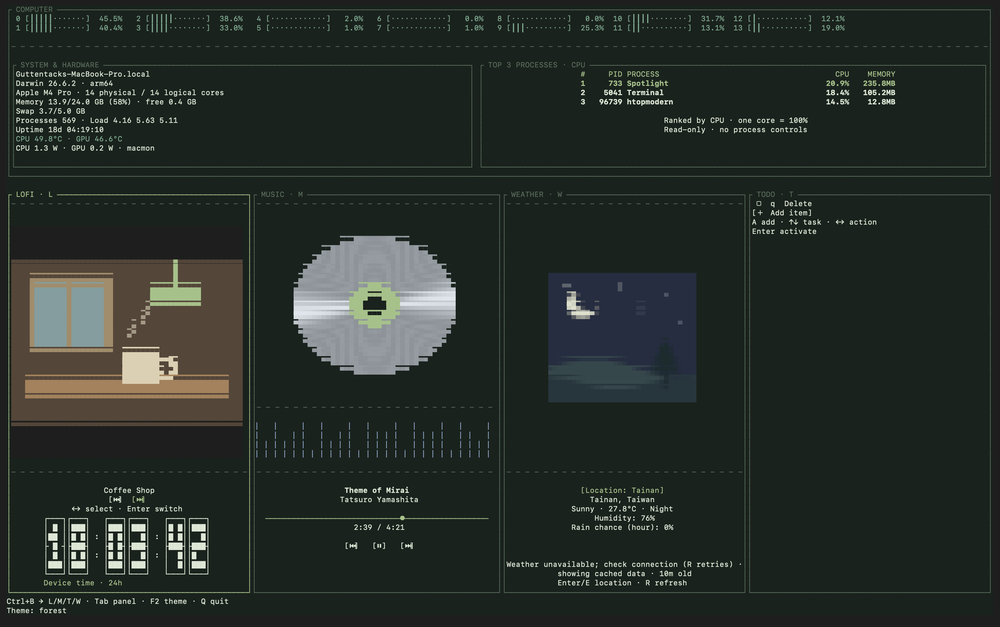
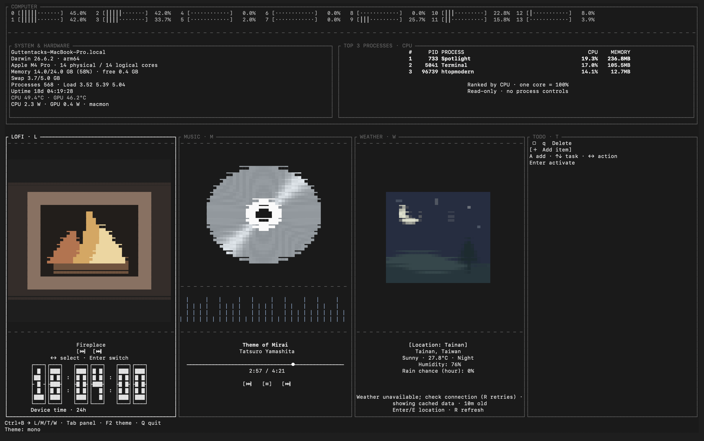

<div align="center">

# htopModern

**A little focus. A little music. A cozier terminal.**

Live Mac monitoring · Lo-fi scenes · Apple Music · Weather · Todos

[](https://github.com/TerrifyGary/htopModern/releases)
[](LICENSE)
[](https://github.com/TerrifyGary/homebrew-tap/actions/workflows/test.yml)

[Get started](#install-with-homebrew) · [Controls](#keyboard-controls) · [Build it yourself](#build-and-check-from-source) · [Code guide](docs/DEVELOPMENT.md)

</div>

Turn your terminal into a calm workspace: keep an eye on your Mac, watch the fireplace, control your music, and jot down your next task.

> **macOS · Apple Silicon · Keyboard first** — launch with `htm`, switch panels with `Tab`, and quit with `Q`.



## Install with Homebrew

For Apple Silicon Macs with Homebrew installed:

```sh
brew install TerrifyGary/tap/htopmodern
htm
```

`htopmodern` is also installed. This first release builds from source, so installation takes longer than installing a prebuilt package. Homebrew handles Rust and the `macmon` temperature helper automatically. No sudo password is needed for the app’s sensor readings.

```sh
brew upgrade TerrifyGary/tap/htopmodern
brew uninstall htopmodern
```

Uninstalling keeps your personal tasks, settings, and weather cache. Release 0.1.0 has been tested on an Apple Silicon Mac running macOS 26.6.2; other macOS versions and terminal graphics implementations have not all been verified. Intel Macs and Linux are not supported by the initial Homebrew formula.

## Features

| Panel | Make yourself at home |
| --- | --- |
| **COMPUTER** | Per-core CPU meters, memory, swap, uptime, hardware details, and highlighted top-three processes. CPU/GPU temperature and power through `macmon`. |
| **LOFI** | Animated **Fireplace**, **Beach**, and **Coffee Shop** scenes, paired with a flip-style digital clock. |
| **MUSIC** | Apple Music controls, track details, a spinning CD that pauses with your music, a decorative equalizer, and a moving progress dot. |
| **WEATHER** | Your city’s temperature in °C, humidity, hourly precipitation probability, and a landscape that follows the weather and daylight. Taipei is the default. |
| **TODO** | Add, complete, and delete tasks. Your list stays saved between sessions. |
| **THEMES** | **Amber · Forest · Ocean · Rose · Mono** — switch with `F2` and keep your preference. |

Process CPU can exceed 100% across multiple cores. The computer panel has no kill controls. Music controls run independently of metadata polling. Weather refreshes every ten minutes and labels cached/offline readings.

Panels are ordered LOFI → MUSIC → WEATHER → TODO. MUSIC is focused at startup. Wide terminals show all four; narrow terminals show the selected panel. Animation/info dividers align across panels.

## Keyboard controls

| Key | Action |
| --- | --- |
| `Q` or `Ctrl+C` | Quit; in text entry, `Esc` cancels, then `Q` quits |
| `Tab` / `Shift+Tab` | Next / previous panel |
| `Ctrl+B`, then `L` / `M` / `W` / `T` | Focus a panel |
| `F2` | Cycle and save theme (some Macs require `Fn+F2`) |
| LOFI or MUSIC: `Left` / `Right`, `Enter` | Select and activate a playback/scene button |
| MUSIC: `R` | Refresh/retry Apple Music |
| WEATHER: `Enter` or `E` | Edit city; `Enter` submits, `Esc` cancels |
| WEATHER: `R` | Refresh weather |
| TODO: `A` | Add item |
| TODO: `Up` / `Down` | Select task or Add item |
| TODO: `Left` / `Right`, `Enter` | Select checkbox/Delete and activate |

In tmux, use Tab because tmux intercepts `Ctrl+B`; configurable prefixes are planned.

```sh
htm --theme ocean
htm --cell-aspect 2.3
htm --version
htm --help
```

Themes and explicit aspect overrides are saved. Terminal character proportions differ: `--cell-aspect` is cell height divided by width and calibrates square graphics. The default fallback is 2.3 when pixel dimensions are unavailable.

## Apple Music and graphics

Start a track in Apple Music. macOS may ask permission for your terminal to control Music. If denied, allow the terminal → Music under **System Settings → Privacy & Security → Automation**, then press `R` in MUSIC. The app does not launch Music automatically. Apple Music streaming/buffering can still add playback latency. YouTube in Firefox requires a separate bridge and is not supported yet.

Weather detects iTerm2, Kitty, or Sixel image support and uses 1024×1024 source frames, encoded in the background at up to four frames per second. Unsupported terminals use colored half-blocks. The footer reports the graphics protocol. LOFI and CD graphics use character cells. The terminal’s physical pixels and font size limit visible detail.

## Data and services

Personal data is stored in `~/Library/Application Support/htopmodern/`:

- `todos.json` — tasks
- `settings.json` — theme and cell proportions
- `weather.json` — last successful location/weather response

Set `HTOPMODERN_DATA_DIR` to use another directory. Existing invalid todo files are reported rather than overwritten. The app contacts [Open-Meteo](https://open-meteo.com/) for the city you enter and displays the first matching city/country. Precipitation probability includes rain and other precipitation types for the current forecast hour. Missing values display as unavailable. Review Open-Meteo’s terms before commercial use. Temperature readings depend on hardware/macOS support in [macmon](https://github.com/vladkens/macmon).

## Build and check from source

```sh
git clone https://github.com/TerrifyGary/htopModern.git
cd htopModern
cargo run --locked
cargo install --path . --locked
```

When building outside Homebrew, install `macmon` separately for temperature: `cargo install macmon --locked` or `brew install macmon`.

```sh
cargo test --locked
cargo clippy --locked -- -D warnings
cargo run --locked -- --check
cargo run --locked -- --temperature-check
cargo run --locked -- --music-check
cargo run --locked -- --weather-check Taipei
```

## Pick your atmosphere

Real screenshots of the terminal app, showing three lo-fi scenes and theme combinations. Cycle scenes in LOFI and press `F2` to change the interface palette.

| Beach · Amber | Coffee Shop · Forest | Fireplace · Mono |
| :---: | :---: | :---: |
| [](docs/images/dashboard-beach.png) | [](docs/images/dashboard-coffee-forest.png) | [](docs/images/dashboard-fireplace-mono.png) |

Click a screenshot to view it at full size. These captures show the half-block graphics fallback and cached weather readings; appearance varies with your terminal and font.

## Explore the code

New to the project? Start with the [developer guide](docs/DEVELOPMENT.md) for a module map, background-worker design, and release workflow. Rust source files include Markdown documentation comments; run `cargo doc --no-deps --document-private-items --open` to browse them locally.

## License

[MIT](LICENSE). Dependencies retain their respective licenses.
