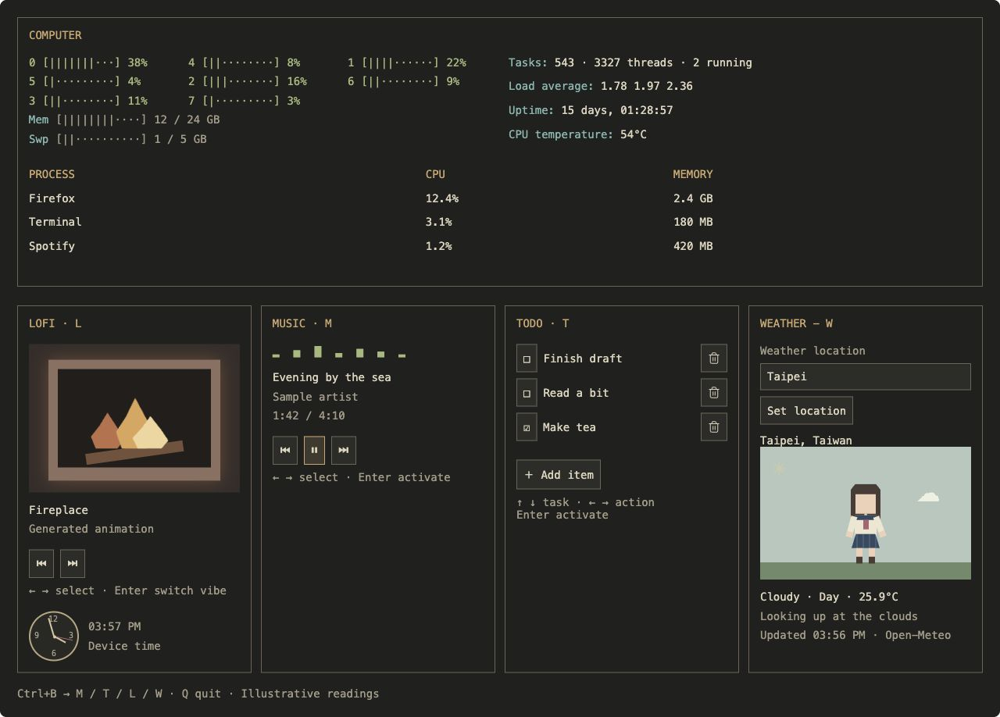

# htopModern

A cozy, vintage-inspired macOS terminal dashboard combining htop-style system monitoring with animated scenes, music controls, todos, and weather.

## Status

The first Rust terminal milestone is implemented: full-screen responsive layout, real CPU/memory/process readings, uptime, and persistent todos. Generated LOFI animations (Fireplace, Beach, Coffee Shop) and a flip-style digital clock are also implemented. Live weather with Celsius temperature, editable location, automatic day/night, and animated weather scenes are implemented. Apple Music playback info and controls are implemented. CPU temperature and Firefox/YouTube integration remain pending. The browser prototype remains the visual reference.

## Run the terminal app

With a stable Rust toolchain installed:

```sh
cargo run --locked
```

To install the command:

```sh
cargo install --path . --locked
htopmodern
```

Cargo installs the executable in `~/.cargo/bin`; that directory must be on your `PATH`.

Use `Ctrl+B` then `L`, `M`, `T`, or `W` to choose a panel, or use Tab. In LOFI, Left/Right selects Previous/Next and Enter changes scene. Scenes use a centered square viewport, accounting for typical terminal cell proportions. The flip-style clock uses device local time in 24-hour format; compact panels show a single-line clock. In WEATHER, Enter or `E` edits the city; Enter submits and Escape cancels. `R` refreshes. Readings are refreshed every ten minutes and cached in `weather.json` alongside todos. Loading and offline states are labeled, and the weather scene stays visible. Requests run in background threads using macOS `/usr/bin/curl`. Location lookup selects the first matching city and displays its resolved country. In TODO, press `A` or select **Add item** and press Enter. Up/Down selects a task, Left/Right selects its checkbox or Delete, and Enter activates it. Enter saves a new task; Escape cancels. `Q` or Ctrl+C exits. In tmux, use Tab for now because tmux intercepts Ctrl+B; configurable prefixes are planned.

Todos are saved to `~/Library/Application Support/htopmodern/todos.json`. Set `HTOPMODERN_DATA_DIR` to override the storage directory. Invalid storage files are reported rather than overwritten. Narrow terminals show the selected bottom panel; widths of at least 110 columns show all four.

```sh
cargo run --locked -- --check  # read-only system snapshot
cargo test --locked
```

## Preview



*Browser design prototype; system metrics and music information are illustrative.*

Open `cozy-terminal-preview.html` in a browser. LOFI scenes and the analog clock run locally. Weather uses Open-Meteo and requires internet access; Taipei is the default location. Weather loading errors are shown without hiding the character.

## Agreed design

- **COMPUTER:** individual CPU meters, memory and swap, task/thread counts, load averages, uptime, CPU temperature where supported, and a simplified process table in the same box. No PID or kill controls.
- **LOFI · L:** generated animated Fireplace, Beach, and Coffee Shop scenes; previous/next scene buttons; flip-style digital clock using device time. No GIF dependency.
- **MUSIC · M:** animated music bars, track and artist, playback timing on its own line, and selectable previous/play-pause/next buttons.
- **TODO · T:** an Add item button with task entry, selectable checkboxes and trash buttons, with persistent local storage planned.
- **WEATHER · W:** editable location defaulting to Taipei; animated sunshine, drifting clouds, wind, rain, and snow, with day/night backgrounds chosen automatically. The scene is a calm landscape with no character or animal. No manual weather or night buttons.
- Terminal app fills the terminal window and responds to resizing, adapting CPU meters and panel layout to available rows and columns.
- Configurable prefix shortcuts, initially `Ctrl+B` followed by `L`, `M`, `T`, or `W`; arrows select controls and Enter activates them. The prefix must be configurable to avoid conflicts with tmux.

## Initial implementation milestones

1. Choose the terminal rendering stack and test animation capabilities in the target terminal.
2. Build a responsive full-screen terminal shell and read real macOS system/process metrics.
3. Verify CPU temperature support on the target Mac.
4. Add generated scenes, analog clock, and persistent todos.
5. Integrate the user's music player and define whether bars are decorative or audio-reactive.
6. Integrate location lookup, weather caching, automatic daylight selection, and offline handling.
7. Package the executable and eventually offer Homebrew installation.

## Weather service

The prototype uses [Open-Meteo](https://open-meteo.com/) geocoding and current weather endpoints. It refreshes every ten minutes and uses the provider's `is_day` value for location-specific daylight. The provider offers free non-commercial API access; review its terms before commercial distribution.

## Open decisions

Target Mac hardware, preferred terminal, music player, implementation language, and final project name remain to be confirmed.

Weather scenes use a centered square viewport based on terminal pixel/cell dimensions when reported. If the terminal does not report pixels, a 2.3:1 cell ratio is assumed; use `cargo run --locked -- --cell-aspect 2.3` or set `HTOPMODERN_CELL_ASPECT=2.3` (cell height divided by cell width) to calibrate your font. Weather artwork uses supersampled color blending; its final detail is still limited by character cells.

The weather illustration is compact (up to 36 columns and 14 rows), preserving the calibrated square aspect ratio.

Native weather graphics: on startup the app detects iTerm2, Kitty, or Sixel support. Supported terminals receive 1024×1024 image frames, encoded on a background thread at up to four frames per second and fitted into the compact square panel. Other terminals retain the half-block fallback. The footer reports the detected graphics protocol. Native image display is constrained by the panel’s physical pixel size; increasing source resolution cannot increase the display’s pixel density.

WEATHER shows relative humidity (%) and chance of precipitation for the current forecast hour (%), alongside Celsius temperature. Rain chance includes all precipitation types, using Open-Meteo’s hourly probability. Missing values and older cache entries show “unavailable” until the next successful refresh.

## Music

MUSIC reads the Apple Music app’s current title, artist, playback position, duration, and playing/paused state. Left/Right selects Previous, Play/Pause, or Next; Enter activates the selected control. `R` retries a failed connection. Polling and commands run in background workers; the bars are decorative playback indicators, not an audio spectrum. The app does not launch Music automatically.

macOS may ask for permission for your terminal to control Music. If denied, enable that terminal’s access to Music in System Settings → Privacy & Security → Automation, then press `R`. The panel shows a connection error instead of retaining stale playback information.

YouTube in Firefox requires a separate browser bridge and is not supported in this milestone. No browser settings or extensions are changed automatically.

`cargo run --locked -- --music-check` performs a read-only Apple Music connection check.

The MUSIC panel includes a CD above the track information. It rotates while playback is reported as playing and holds its angle when paused or stopped (external changes are detected on the next two-second poll). Small panels hide the CD to preserve playback controls.

Press `L` while MUSIC is focused to show/hide lyrics; Up/Down scrolls them. Lyrics come from the current track’s Music scripting field, when provided, and are limited to the first 12,000 characters. This is plain text, not synchronized Apple Music catalog lyrics. An unavailable message is shown when Music exposes no lyrics. The lyrics area appears only when the panel has enough height.
